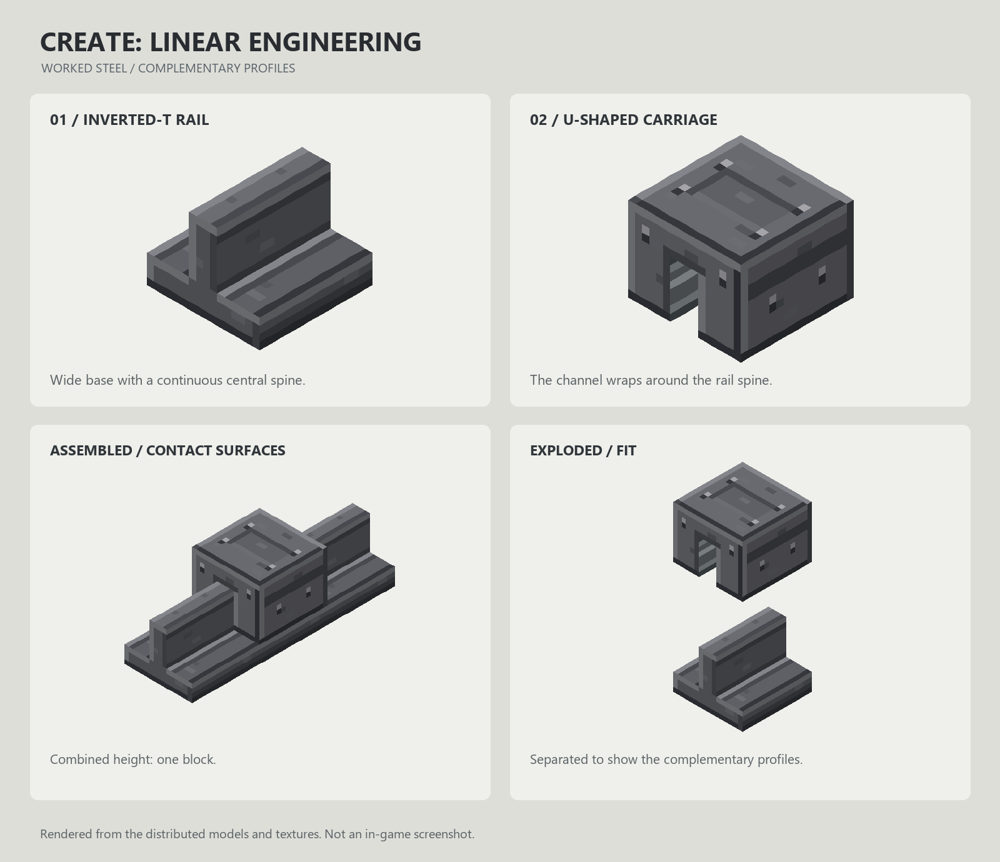
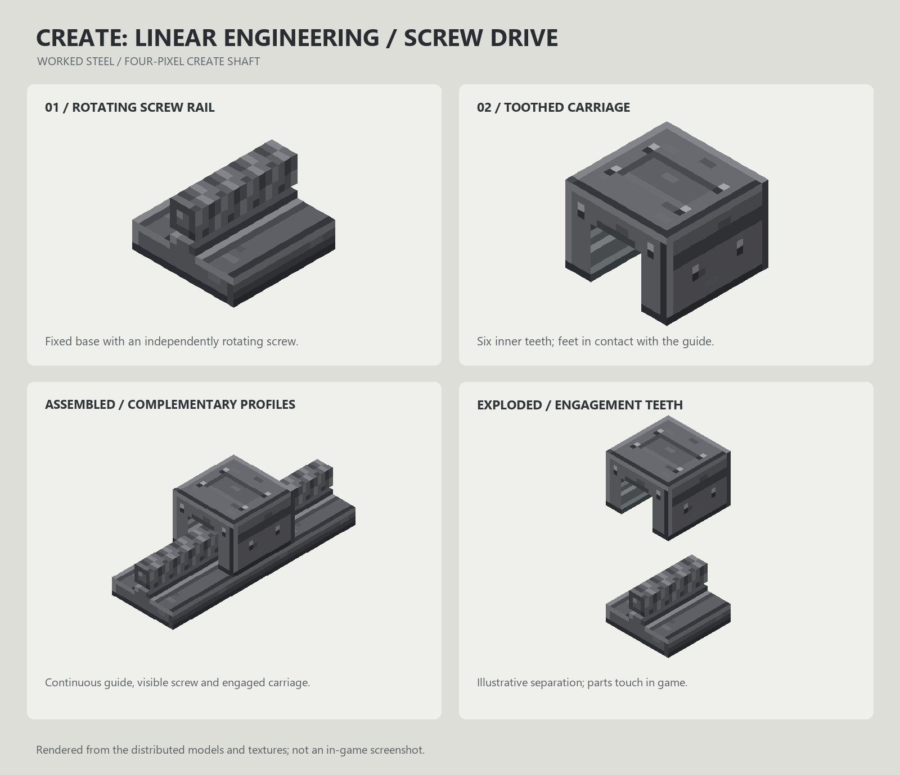
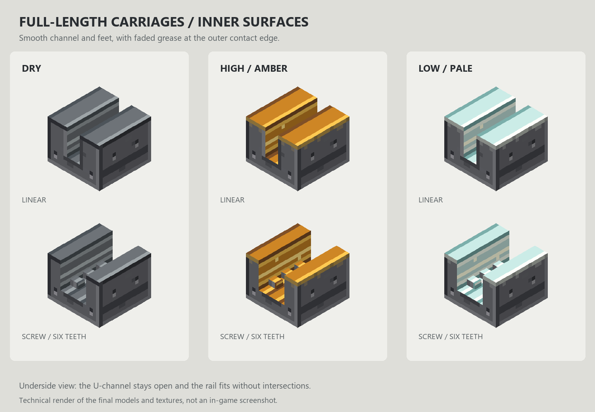
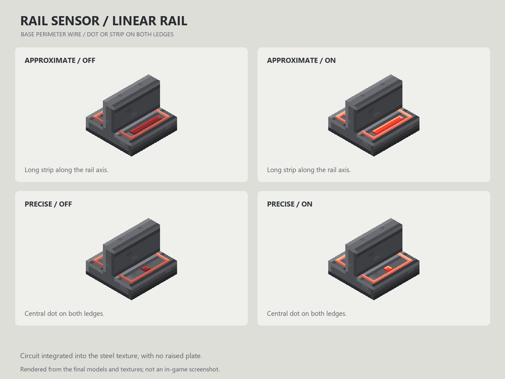

# Create: Linear Engineering

Build sliding doors, lifts and moving machinery with physical carriages, linear guides and Create-powered lead screws. Sable handles rigid bodies, mass, gravity and collisions; Create supplies rotation, stress networks and placement assistance.

**Version 0.8.3 · Minecraft 1.21.1 · NeoForge · Java 21**



## Installation

Install the mod on **both the client and the server**, together with its required dependencies.

| Component | Tested version | Declared compatibility |
|---|---|---|
| Minecraft | 1.21.1 | 1.21.1 |
| NeoForge | 21.1.259 | 21.1.259 to below 21.2 |
| Create | 6.0.10 | 6.0.10 to below 6.1 |
| Sable | 2.0.5 | 2.0.5 to below 2.0.6 |
| Java | 21 | 21 |

Install the dependencies required by Create and Sable as well. These dependencies are not bundled in this mod. Aeronautics is not a direct requirement. Compatibility ranges in the metadata are not a claim that every version or modpack combination has been tested.

The file is `create-linear-engineering-0.8.3.jar`. The registry namespace is `create_linear_engineering`. This is a distinct mod identity: blocks and items saved under a different namespace are not automatically converted. Back up existing worlds before changing their installed mods.

## Blocks and items

| Content | Purpose |
|---|---|
| Linear Rail | Guides a freely sliding physical body along one axis. |
| Linear Carriage | Fits around a Linear Rail and carries an attached structure. |
| Screw Rail | Accepts Create shafts at its ends and transmits rotation along the line. |
| Toothed Carriage | Travels along a Screw Rail when the screw turns and holds when it stops. |
| Rail Sensor | Attaches to either rail family and detects passing carriages. |
| High Viscosity Grease | Halves a free carriage's added brake and reduces screw stress to one quarter. |
| Low Viscosity Grease | Removes a free carriage's added brake and reduces screw stress to one sixteenth. |

Both carriages are one block long. The inverted-T rail and U-shaped carriage have complementary profiles that fit together within one block in height.

## Getting started

1. Place a rail against a floor, wall or ceiling. Its base follows the clicked face; adjacent rails preserve the line's orientation.
2. Hold another rail and aim at the existing line. Create's native arrow and placement preview help extend it. Hold Shift to bypass placement assistance.
3. Right-click a matching rail with a carriage. It is created directly as a fitted Sable body. Carriages cannot be placed freely in the world or on top of an overlapping carriage.
4. Build the payload on the moving body. A free carriage responds to forces and gravity without rotational power. Dry carriages brake strongly; grease changes how freely they slide.
5. Add solid blocks where you need physical stops. There are no invisible end stops: a carriage that fully leaves an open rail end detaches and continues as a free physical body.
6. Bring a detached carriage back into an aligned rail profile to reconnect it automatically. The rail axis and mounting face must match. Re-entry also works on moving rails; it does not attract distant carriages or correct an incompatible approach.

Floor, ceiling and wall mounting support 24 signed orientations, including rails on moving or rotated Sable bodies. Opposite directions along the same axis are compatible when the mounting faces agree.

## Joining carriages

Build the connecting structure so the two physical bodies touch by a face, on the same block grid, with no overlapping blocks. Click the first carriage and then the second using a Create wrench. The first body is retained and the second body and its payload are transferred into it, preserving their guide joints.

There is no fixed limit of two carriages: repeat the operation to add more. Each merge transfers at most **2,048 blocks** and scans a bounding-box volume no larger than **129 cubed**. All guides must allow compatible movement. Shift-right-click a rail or carriage with the wrench to clear a selection. Breaking the physical connection lets Sable split the body again.

## Screw drives

Connect a Create shaft to either end of a Screw Rail. Connected rail segments transmit rotation; only the central four-pixel-wide screw rotates. Toothed Carriages fit only on Screw Rails, and Linear Carriages fit only on Linear Rails.

One revolution advances a carriage **one quarter of a block**. At 64 RPM the target speed is about 0.267 blocks per second; at 128 RPM it is about 0.533. Reverse the RPM to reverse travel. At zero RPM or during network overstress, the screw holds the carriage within the native physics solver's tolerance, including against external impacts.

Empty rails have no stress impact. Each engaged carriage contributes:

```text
shared_mass = body_mass / engaged_screw_carriages_on_that_body
impact = (0.25 + shared_mass / 128) * grease_factor
stress_SU = impact * abs(RPM)
```

The grease factor is 1 when dry, 1/4 with High Viscosity Grease and 1/16 with Low Viscosity Grease. Multiple carriages share their body's mass rather than counting it repeatedly. Connected drives must command compatible directions and speeds.

See [lubrication, mass and stress](docs/lubrication-and-stress.md) for examples, hand-crank capacity and physical limits.



## Lubrication

Right-click a carriage with grease to apply a permanent treatment. Applying another type replaces it; applying the same type again consumes nothing. Application consumes one item in survival and none in creative. Grease cannot be applied to rails and is not recovered when the carriage is broken.

Dry sliding surfaces are metallic, High Viscosity surfaces are amber and Low Viscosity surfaces are pale. A faded trace on the exposed contact edge makes the treatment visible while the carriage is mounted. The underside of the feet uses the same smooth finish as the inner channel.

Low Viscosity Grease removes only this mod's added brake. Sable's ordinary drag and contact behavior still apply. Free carriages remain affected by gravity; grease does not turn a free guide into a parking brake. Lubricated screw carriages still hold at zero RPM.



## Rail Sensor

Right-click either rail family with a Rail Sensor to install it in the existing block. The circuit is part of the rail's opaque block texture and does not obstruct the carriage. Only one sensor can be installed per segment. Placement assistance does not copy sensors when extending a line.

- **Approximate:** detects any longitudinal overlap with the rail segment. Neighboring sensors may both activate during a transition.
- **Precise:** detects the carriage center within **1/32 block** of the segment center. The carriage must also be aligned with that guide.
- **Shift-right-click with a Create wrench** switches modes and clears a pending carriage selection.
- Output strength is **15, only behind the rail base**. This is weak power, allowing directly adjacent lamps to activate individually. The output direction follows floor, wall and ceiling mounting, including rails on the same moving body.
- Breaking the rail in survival drops both the rail and its installed sensor. The wrench does not remove the sensor separately.

Fast crossings are detected from the carriage's actual motion between physics steps. An activation lasts at least two game ticks, and remains on while the detection area is occupied. A Precise pulse may report a center that has just crossed: the sensor is not an automatic brake or a guarantee of a perfectly centered stop at every speed.



## Recipes and tutorials

All seven blocks and items have crafting recipes. The Screw Rail recipe combines a Linear Rail with a Create shaft; the Toothed Carriage recipe combines a Linear Carriage with a brass ingot. Slimeball plus honeycomb produces two High Viscosity Grease; slimeball plus kelp produces two Low Viscosity Grease. A redstone dust above andesite alloy, quartz and andesite alloy produces two Rail Sensors.

Open the **Create: Linear Engineering** creative tab to find the content. Hold **W** on supported items to open eleven native Ponder tutorials covering placement, assembly, physics, gravity, mounting, joining, re-entry, screw drives, lifting, sensors and lubrication. Tutorials are explanatory animations rather than live physics simulations. All supplied names, messages and tutorial text are in English.

## Building and testing

With JDK 21 installed:

```powershell
./gradlew.bat build
./gradlew.bat runGameTestServer
```

On Linux or macOS, use `./gradlew`. Distribution and source JARs are written to `build/libs/`. GameTest sources are separate from the distributed mod.

The integration suite contains **107 native GameTests**, using Sable and Rapier rather than mocked physics. It covers all mounting orientations, gravity, friction, impacts, open ends, re-entry, moving parents, transfers, joining, persistence, protection events, sensors and kinetic stress. The generated `run/gametest/world` is recreated before each test run. CI builds and runs the suite with Java 21.

See the [technical specification](docs/technical-specification.md), [development guide](docs/development.md) and [changelog](CHANGELOG.md).

## Scope and limitations

- Straight guides only; no curved rails or conversion of moving bodies back into static blocks.
- Native solver tolerances remain. Physical stops do not guarantee mathematically zero movement or universal continuous collision detection against every independent moving body.
- Merging permits relative quarter-turn rotations around local Y. Other relative tilts must be aligned first. A supporting rail body cannot be merged with its own descendant.
- Legacy static-carriage assembly is limited to 2,048 blocks, a 64-block coordinate reach and 256 initial rail segments. It rejects unloaded or immovable glued payloads. Newly placed carriages are already physical bodies and do not scan an entire rail line.
- Cross-dimension transport is delegated to Sable's body-group transport facilities; this mod does not implement a separate transporter.
- Physics tests run near the origin. Very large coordinates remain subject to the backend's floating-point precision.

## License and dependencies

Project code and assets are distributed under the [MIT License](LICENSE). Dependencies retain their own licenses and are installed separately. The Gradle wrapper is standard Apache-2.0 tooling.

- [Create](https://github.com/Creators-of-Create/Create): kinetic networks, stress, placement assistance and rendering conventions.
- [Sable](https://github.com/ryanhcode/sable): physical sublevels, rigid bodies, joints and spatial queries.
- [NeoForge](https://github.com/neoforged/NeoForge): loader, registries and placement events.

Documentation renders are generated from the distributed model JSON and texture PNG files; they are not in-game screenshots.
